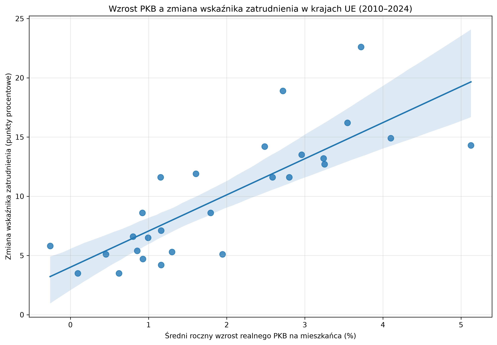
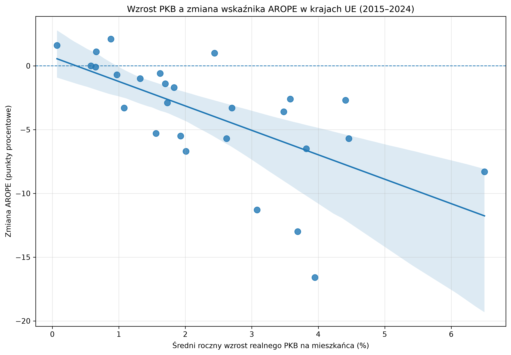
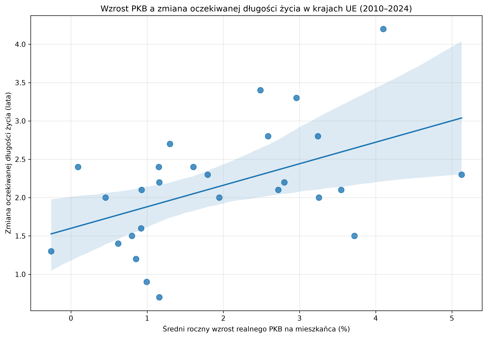
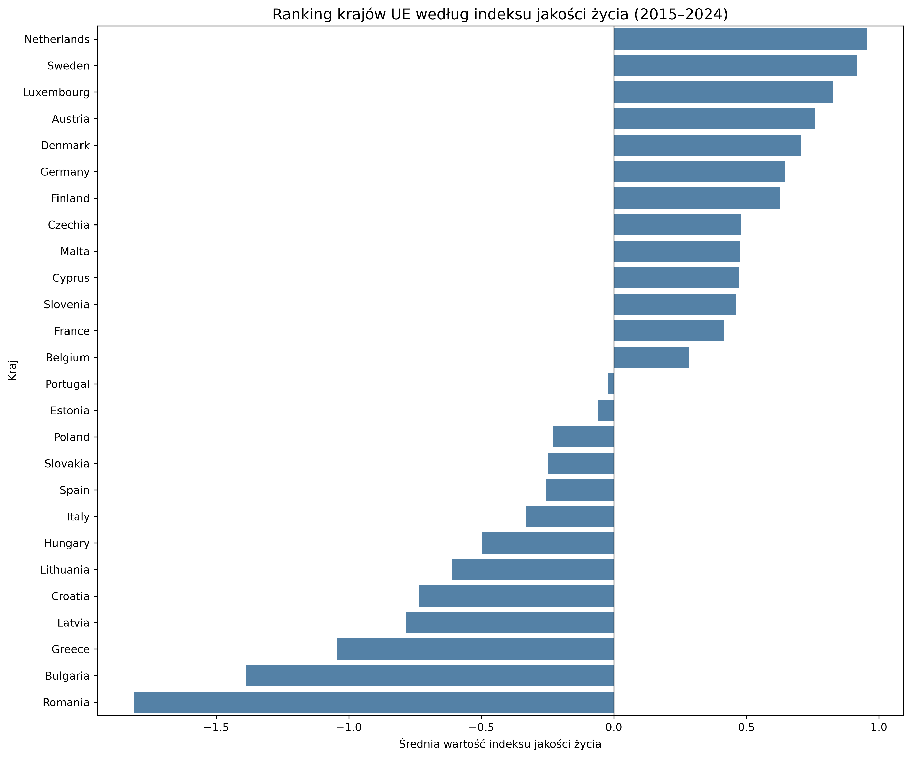
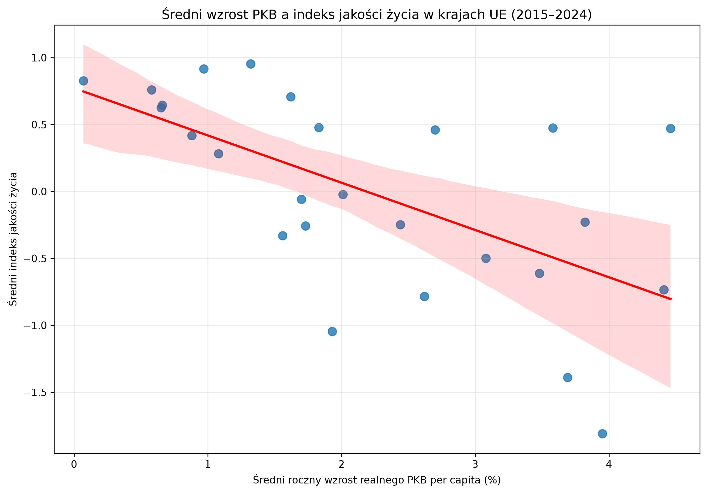

# Economic Growth and Quality of Life in European Union Countries (2010-2024)

## Project Overview

This project examines the statistical relationship between economic growth and quality of life across 27 EU Member States between 2010 and 2024.

The analysis uses annual socioeconomic data from Eurostat.
The study is quantitative, comparative and observational.
The results describe statistical associations, not causal relationships.

## Research Objectives

- Examine GDP growth and household income.
- Analyse economic growth and employment.
- Investigate GDP growth and poverty or social exclusion.
- Assess economic growth and life expectancy.
- Construct a composite quality-of-life index.

## Data and Indicators

| Indicator | Period |
|---|---|
| Real GDP per capita growth | 2010-2024 |
| Median equivalised disposable income | 2010-2024 |
| Employment rate (age 20-64) | 2010-2024 |
| AROPE | 2015-2024 |
| Life expectancy at birth | 2010-2024 |

**Data source:** [Eurostat](https://ec.europa.eu/eurostat)

## Methodology

- Data collection and cleaning using Python.
- Descriptive statistics.
- Pearson and Spearman correlations.
- Ordinary Least Squares (OLS) regression.
- Panel models with country and year fixed effects.
- Robust standard errors and sensitivity analysis.
- Composite quality-of-life index using standardized indicators.

The composite index combines income, employment, reversed AROPE and life expectancy with equal weights.
It is standardized separately for each year and measures relative positions between countries.

## Key Findings

| Relationship | Pearson correlation |
|---|---:|
| GDP growth and real income growth | 0.866 |
| GDP growth and employment improvement | 0.810 |
| GDP growth and change in AROPE | -0.638 |
| GDP growth and life expectancy improvement | 0.489 |
| GDP growth and composite quality-of-life index | -0.611 |

Stronger economic growth is associated with faster real income growth and improvements in employment.
Higher GDP growth is also associated with larger reductions in the risk of poverty or social exclusion.
The relationship with life expectancy is weaker.

The negative cross-country association with the composite index requires careful interpretation.
The index measures relative country positions, not absolute improvements over time.
Panel analysis identifies a positive association between lagged GDP growth and changes in the index.

## Selected Visualisations

### GDP Growth and Employment



### GDP Growth and AROPE



### GDP Growth and Life Expectancy



### Quality-of-Life Ranking



### GDP Growth and Quality of Life



## Repository Structure

- `data/raw/` - raw data
- `data/processed/` - processed datasets
- `figures/` - charts and visualisations
- `notebooks/` - Jupyter notebooks
- `reports/` - research reports
- `requirements.txt` - Python dependencies

## Technologies

Python 3, Jupyter Notebook, pandas, NumPy, Matplotlib, Seaborn, SciPy and statsmodels.

## How to Run the Project

Clone the repository:

```bash
git clone https://github.com/kamilkrzepina1/economic-growth-quality-of-life.git
cd economic-growth-quality-of-life
pip install -r requirements.txt
jupyter notebook
```

Open `notebooks/01_data_collection.ipynb` and run the notebook cells.

## Limitations

- The study is observational and does not establish causality.
- The composite index covers 26 countries because of income data comparability limitations.
- AROPE data cover a shorter period (2015-2024).
- Statistical methodology changes may affect comparability.
- Ireland's GDP statistics can be strongly influenced by multinational enterprise activity.
- Panel models cover a relatively short period and a limited number of country clusters.

## Conclusion

Economic growth is positively associated with several socioeconomic outcomes, particularly real income growth and employment improvements.
However, quality of life is multidimensional, and GDP growth alone does not explain all differences in social outcomes.

## Author

**Kamil Krzepina**

Project type: Quantitative socioeconomic analysis
Data source: Eurostat
Study period: 2010-2024
